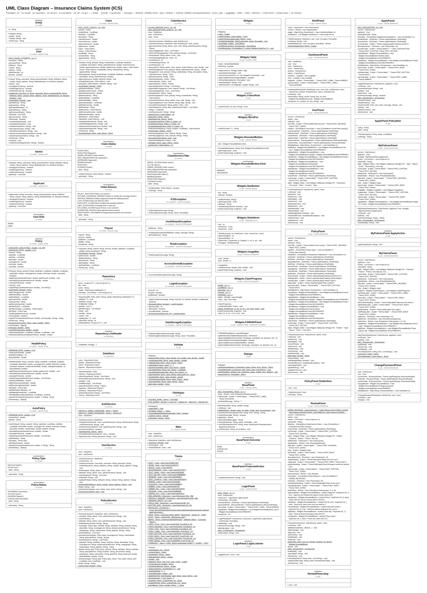

# Insurance Claims System (ICS)

A stand-alone **Java Swing** desktop application for managing insurance **policies** and **claims**, built for
**IT203** (final project). It applies object-oriented programming (encapsulation,
inheritance, polymorphism, abstraction) and stores all data in **ArrayLists and txt files**

> Group: 1 · Members: Tejada, Ceejay H. Angeles, Danrae R. Tayao, Renz Gabriel S. · Section: 2CG1

## Contents
1. [What the system does](#1-what-the-system-does)
2. [Architecture](#3-architecture)
3. [UML class diagram](#4-uml-class-diagram)
4. [Business rules and computations](#5-business-rules-and-computations)
5. [Data storage (txt files)](#6-data-storage-txt-files)
6. [Testing](#7-testing)
7. [Future improvements](#8-Future-improvements)

## 1. What the system does

There are two kinds of account. Only the **Admin** creates accounts (there is no public sign-up).

| Role | Can do |
|---|---|
| **Admin** | Create, edit, deactivate, unblock and delete accounts · issue, edit, cancel and delete Health and Auto policies · review claims: approve (releases the payout and prints a slip), deny with a reason, or ask the User for more information |
| **User** (policyholder) | See their own policies · apply for a claim (with a live payout estimate and automatic checks) · follow their claims, reply to the Admin, and print their payout slip |
| **Everyone** | Log in (3 wrong passwords block the account and close the program; only an Admin can unblock) · change their own password |

## 2. Architecture

Three layers, each talking only to the one below it, plus the model shared by all:

| Layer | Package | Job |
|---|---|---|
| Screens | `ics.gui` | Show data and collect input. Never decide anything. |
| Rules | `ics.service` | Every business rule: login, accounts, policies, claims, payouts. |
| Storage | `ics.repository` | Keep records in ArrayLists while running and in txt files on disk. |
| Data | `ics.model` | The records themselves: User, Policy, Claim, Payout. |
| Errors | `ics.exception` | One exception class per kind of problem. |
| Helpers | `ics.util` | Input checks (`Validate`) and the file format (`FileHelper`). |

**OOP in the code**

| Principle | Where |
|---|---|
| Inheritance | `Admin` and `Applicant` extend `User`; `HealthPolicy` and `AutoPolicy` extend `Policy`; every record extends `Entity`; every screen extends `BasePanel` |
| Polymorphism | `calculatePremium()` and `calculatePayout()` differ in `HealthPolicy` and `AutoPolicy`; `canManageUsers()` differs in `Admin` and `Applicant` (the sidebar is built from it) |
| Encapsulation | All fields are `private`; a claim's status changes only through `changeStatus()`, which allows only legal moves (`Claim.Status.canMoveTo()`) |
| Abstraction | `Entity`, `User` and `Policy` are abstract; screens call `policy.calculatePayout()` without knowing the formula |

## 3. UML class diagram



The full class diagram of the system: **62 classes** from the program’s 38 source files (nested classes are shown as `Outer.Inner`;).
It is COME from the compiled code, so every class, attribute, default value, constructor and method matches
the source. For zooming in, open the PDF version: [`docs/uml/ICS-UML-Class-Diagram.pdf`](docs/uml/ICS-UML-Class-Diagram.pdf).

**Notation**
- `+` public · `-` private · `#` protected · `~` package
- attribute: `visibility name : type = default`
- method: `visibility name(parameters) : return_type`
- <u>underline</u> = static · *italic* = abstract
- «abstract», «interface» and «enumeration» are written above the class name


### 3.1 Relationships

The big diagram lists every member; this one shows how the records connect. Records refer to each other by **ID**
(like foreign keys), because each is stored in its own txt file: a User owns policies (`ownerId`), a Policy has claims
(`policyId`), and an approved Claim has one payout (`claimId`).

```mermaid
classDiagram
    direction TB
    class Entity {
        <<abstract>>
        -String id
        +getId() String
        +setId(String) void
        +toFileLine()* String
    }
    class User {
        <<abstract>>
        +int MAX_FAILED_ATTEMPTS$
        -String username
        -String passwordHash
        -String fullName
        -String contact
        -String address
        -int failedAttempts
        -boolean blocked
        +block() void
        +canApplyForClaims()* boolean
        +canManageUsers()* boolean
        +canReviewClaims()* boolean
        +create(Role, String, String, String, String, String, String, int, boolean)$ User
        +fromFields(String[])$ User
        +getAddress() String
        +getContact() String
        +getFailedAttempts() int
        +getFullName() String
        +getPasswordHash() String
        +getRole()* Role
        +getUsername() String
        +isBlocked() boolean
        +recordFailedAttempt() void
        +resetFailedAttempts() void
        +setAddress(String) void
        +setContact(String) void
        +setFullName(String) void
        +setPasswordHash(String) void
        +setUsername(String) void
        +toFileLine() String
        +unblock() void
        +verifyPassword(String) boolean
    }
    class Admin {
        +canApplyForClaims() boolean
        +canManageUsers() boolean
        +canReviewClaims() boolean
        +getRole() Role
    }
    class Applicant {
        +canApplyForClaims() boolean
        +canManageUsers() boolean
        +canReviewClaims() boolean
        +getRole() Role
    }
    class Policy {
        <<abstract>>
        +double DISCOUNT_DEDUCTIBLE$
        +double DISCOUNT_RATE$
        -String ownerId
        -LocalDate startDate
        -LocalDate endDate
        -double deductible
        -double coverageLimit
        -double limitUsed
        -boolean cancelled
        #amount(String, double)$ String
        +applyPayout(double, double) void
        +calculatePayout(double)* double
        +calculatePremium()* double
        +cancel() void
        +explainPayout(double)* List~String~
        #extraFields()* Object[]
        +fromFields(String[])$ Policy
        +getCoverageLimit() double
        +getDeductible() double
        +getEndDate() LocalDate
        +getLimitUsed() double
        +getOwnerId() String
        +getRemainingLimit() double
        +getStartDate() LocalDate
        +getStatus(LocalDate) PolicyStatus
        +getType()* PolicyType
        +hasDeductibleDiscount() boolean
        +isCancelled() boolean
        +payoutFormula(double, String)* String
        #php(double)$ String
        #roundToCents(double)$ double
        +toFileLine() String
        #withDeductibleDiscount(double) double
    }
    class HealthPolicy {
        +double PREMIUM_RATE$
        -double reimbursementRate
        -int waitingPeriodDays
        -double deductibleMet
        +applyPayout(double, double) void
        +calculatePayout(double) double
        +calculatePremium() double
        +explainPayout(double) List~String~
        #extraFields() Object[]
        +getDeductibleMet() double
        +getReimbursementRate() double
        +getRemainingDeductible() double
        +getType() PolicyType
        +getWaitingPeriodDays() int
        +getWaitingPeriodEnd() LocalDate
        +isInWaitingPeriod(LocalDate) boolean
        +payoutFormula(double, String) String
    }
    class AutoPolicy {
        +double PREMIUM_RATE$
        -double vehicleValue
        -String plateNo
        +calculatePayout(double) double
        +calculatePremium() double
        +explainPayout(double) List~String~
        #extraFields() Object[]
        +getPlateNo() String
        +getType() PolicyType
        +getVehicleValue() double
        +payoutFormula(double, String) String
    }
    class Claim {
        +int MAX_NOTE_LENGTH$
        -String policyId
        -LocalDate incidentDate
        -LocalDate filedDate
        -String description
        -double claimedAmount
        -double reserveAmount
        -double approvedAmount
        -double paidAmount
        -ClaimStatus status
        -ClaimReason reason
        -String handledBy
        -String reviewerNote
        -String applicantNote
        +approve(double, String) void
        +changeStatus(ClaimStatus) void
        +deny(ClaimReason, String) void
        +fromFields(String[])$ Claim
        +getApplicantNote() String
        +getApprovedAmount() double
        +getClaimedAmount() double
        +getDescription() String
        +getFiledDate() LocalDate
        +getHandledBy() String
        +getIncidentDate() LocalDate
        +getPaidAmount() double
        +getPolicyId() String
        +getReason() ClaimReason
        +getReserveAmount() double
        +getReviewerNote() String
        +getStatus() ClaimStatus
        +reject(ClaimReason) void
        +setApplicantNote(String) void
        +setHandledBy(String) void
        +setReserveAmount(double) void
        +setReviewerNote(String) void
        +toFileLine() String
    }
    class Payout {
        -String claimId
        -double amount
        -LocalDate paidDate
        -String paidBy
        -String breakdown
        +fromFields(String[])$ Payout
        +getAmount() double
        +getBreakdown() String
        +getClaimId() String
        +getPaidBy() String
        +getPaidDate() LocalDate
        +toFileLine() String
    }
    class Role {
        <<enumeration>>
        ADMIN
        USER
    }
    class PolicyType {
        <<enumeration>>
        HEALTH
        AUTO
    }
    class PolicyStatus {
        <<enumeration>>
        UPCOMING
        ACTIVE
        EXPIRED
        CANCELLED
    }
    class ClaimStatus {
        <<enumeration>>
        FILED
        REJECTED
        UNDER_REVIEW
        INFO_REQUESTED
        APPROVED
        DENIED
        PAID
        CLOSED
    }
    class ClaimReason {
        <<enumeration>>
        POLICY_INACTIVE
        OUTSIDE_COVERAGE_PERIOD
        WAITING_PERIOD
        LATE_FILING
        DUPLICATE_CLAIM
        LIMIT_EXHAUSTED
        EXCLUDED_CAUSE
        SUSPECTED_FRAUD
        INSUFFICIENT_DOCUMENTS
    }
    Entity <|-- User
    Entity <|-- Policy
    Entity <|-- Claim
    Entity <|-- Payout
    User <|-- Admin
    User <|-- Applicant
    Policy <|-- HealthPolicy
    Policy <|-- AutoPolicy
    User "1" <-- "0..*" Policy : ownerId (owns)
    Policy "1" <-- "0..*" Claim : policyId (claimed on)
    Claim "1" <-- "0..1" Payout : claimId (pays)
    User "1" <-- "0..*" Claim : handledBy (Admin who decided)
    User "1" <-- "0..*" Payout : paidBy (Admin who released)
    User ..> Role
    Policy ..> PolicyType
    Policy ..> PolicyStatus
    Claim --> ClaimStatus : status
    Claim --> ClaimReason : reason
```



Other relationships in the big diagram:
- **Inheritance:**
  - `Admin` and `Applicant` extend `User`.
  - `HealthPolicy` and `AutoPolicy` extend `Policy`.
  - All four records extend `Entity`.
  - The five exceptions extend `ICSException`.
  - Every screen extends `BasePanel`.
- **Composition:** `DataStore` is made of four `Repository<T>` objects, one per txt file.
- **Dependency:** `UserService`, `PolicyService` and `ClaimService` use `AuthService` (password checks) and `DataStore` (storage).
- **Screens:** `ShellPanel` holds one screen per role, and `Main` switches between `LoginPanel` and `ShellPanel`.

## 4. Business rules and computations

**Premium**
- Health: **4% of the coverage limit**. Auto: **3% of the vehicle value**.
- **10% off** either one when the deductible is ₱10,000 or more.
- *Example:* car worth ₱800,000 with a ₱10,000 deductible: 800,000 × 0.03 = 24,000 − 10% = **₱21,600**.

**Payout** (never more than the coverage limit left)
- Auto: `min(repair cost − deductible, limit left)`. The deductible applies to **every** claim.
  *Example:* 120,000 − 10,000 = **₱110,000**.
- Health: `min((bill − deductible still unpaid) × reimbursement %, limit left)`. The deductible is paid **once** per policy.
  *Example:* (50,000 − 5,000) × 80% = **₱36,000**.

**Policy rules**
- Holder must be a User account.
- At most 1 year long.
- Deductible lower than the limit.
- Auto: limit not above the vehicle value.
- No double insurance: Auto checked by **plate number**, Health by **holder**; cancelled policies are ignored.
- A policy with claims cannot be deleted (cancel it instead).
- Status is computed from the dates: Upcoming, Active, Expired, Cancelled.

**Automatic claim checks** (a failed check saves the claim as **Rejected** with its reason):
1. The policy is not cancelled.
2. The incident is inside the coverage dates.
3. It is past the Health waiting period.
4. It is filed within 90 days.
5. The same incident was not already claimed.
6. The coverage limit is not used up.

No claims are accepted on an Upcoming policy.

**Claim life cycle**
```
FILED ─▶ UNDER_REVIEW ─▶ APPROVED (payout released, slip printed) ─▶ CLOSED
   │          │  └──────▶ DENIED (reason required) ─────────────────▶ CLOSED
   │          └─▶ INFO_REQUESTED ─▶ (User replies) ─▶ UNDER_REVIEW
   └─▶ REJECTED (automatic check failed)
```

**Security**
- Passwords stored as SHA-256 hashes.
- 3 wrong passwords block the account (the count is saved immediately) and close the program.
- The Admin re-types the password before deleting, cancelling or approving money.

## 5. Data storage (txt files)

Four files in `ICS-data`, one record per line, fields separated by `|` (a typed `|` is saved as `\p`):

```
users.txt     id | role | username | passwordHash | fullName | contact | address | failedAttempts | blocked
policies.txt  id | type | ownerId | start | end | deductible | coverageLimit | limitUsed | cancelled | extras...
              HEALTH extras: reimbursementRate | waitingPeriodDays | deductibleMet
              AUTO extras:   vehicleValue | plateNo
claims.txt    id | policyId | incidentDate | filedDate | description | claimed | reserve | approved | paid
              | status | reason | handledBy | reviewerNote | applicantNote
payouts.txt   id | claimId | amount | paidDate | paidBy | breakdown
```
- **IDs** are auto-numbered (`USR-0001`, `POL-0001`, `CLM-0001`, `PAY-0001`): highest number + 1.
- **Saving** writes a temporary file first, then swaps it in.
- **Damaged lines** are skipped with a warning, and a `.bak` copy is kept.

## 6. Testing

- A 50-case manual test plan was run on the Ceewaii laptop

## 7.future improvements
- Future work: message history, premium receipts, a separate Staff role. IF IT'S GONNA CONTINUE? i hope so...


"akala ko basic lang deductible, hindi pala. ako pala ang nadeductan ng tulog shet."
> > — Ceejay H. Tejada - < Logging off
